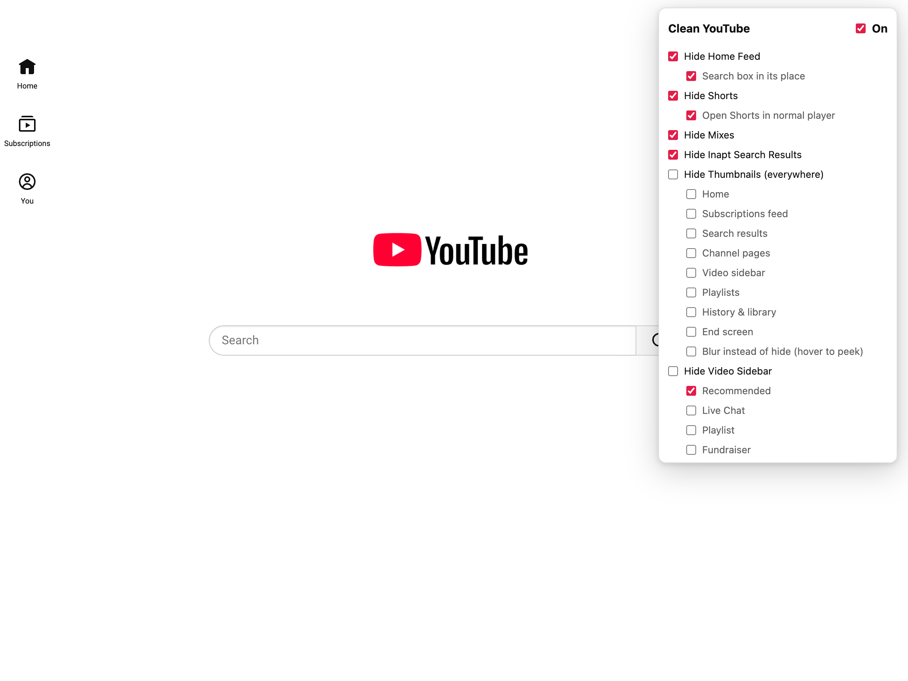
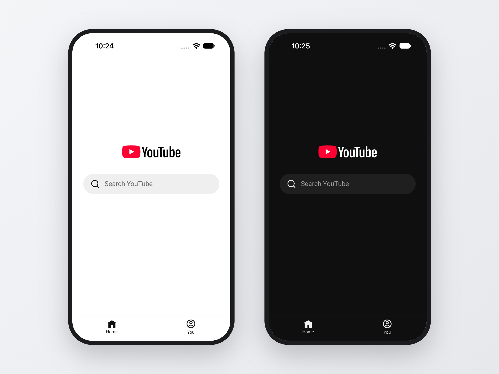

# Clean YouTube

Hide YouTube's feeds, Shorts, recommendations, and thumbnails so you can search without doom scrolling. A single Manifest V3 build runs in Chrome, Firefox (142+, desktop and Android), and Safari on macOS and iOS.





## Install (unpacked)

**Chrome / Edge / Brave:** open `chrome://extensions`, turn on Developer mode, click **Load unpacked**, and choose the `extension/` folder.

**Firefox:** open `about:debugging#/runtime/this-firefox`, click **Load Temporary Add-on**, and choose `extension/manifest.json`. Temporary add-ons are removed when Firefox restarts. To keep it installed, sign the zip on [addons.mozilla.org](https://addons.mozilla.org/developers/) (an unlisted listing is fine).

**Safari (macOS / iOS):** open `safari/Clean YouTube/Clean YouTube.xcodeproj` in Xcode, pick your own team under Signing & Capabilities if you aren't the author, and run the **Clean YouTube (macOS)** or **Clean YouTube (iOS)** scheme. Then enable it in Safari → Settings → Extensions (macOS; for unsigned dev builds also turn on Develop → Allow Unsigned Extensions) or Settings → Apps → Safari → Extensions (iOS). The Xcode project references the files in `extension/`, so there's nothing to copy after edits; just rebuild.

## Package for the stores

```sh
npx web-ext lint --source-dir extension
npx web-ext build --source-dir extension --artifacts-dir web-ext-artifacts
```

Upload the same zip to the Chrome Web Store and to AMO. Bump `"version"` in `extension/manifest.json` for each update. For Safari, use Product → Archive in Xcode and upload to App Store Connect.

Listing text, privacy answers, and screenshots sized for each store are in [`store-assets/`](store-assets/).

## Adding or fixing an option

Every toggle lives in `extension/options.js`. Both the popup and the page styles are generated from that list. When YouTube changes its markup, update the matching `hide` selector there. `ytd-*` selectors are for www.youtube.com and `ytm-*` ones are for m.youtube.com, the mobile site iPhone Safari loads.
